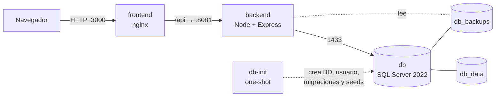

# Nova Salud — Guía de Docker

> ⚠️ **NOTA DE BORRADOR — eliminar al terminar la Fase 10 de `PROMPT_MAESTRO.md`.**
> Describe el **estado objetivo** de la infraestructura (servicio `db-init`, proxy `/api` en nginx, scripts de respaldo, etc.). El `docker-compose.yml` actual del repositorio **no hace todo esto todavía**: hoy solo crea `sa` en SQL Server y no ejecuta los scripts SQL, por lo que el backend no puede conectar. Valida cada comando en un clon limpio antes de dar este documento por bueno.

Todo lo necesario para construir, ejecutar, operar, respaldar y diagnosticar Nova Salud con Docker. Para el resto del proyecto (módulos, usuarios demo, ejecución sin Docker) ver [README.md](README.md).

---

## Contenido

1. [Arquitectura](#arquitectura)
2. [Servicios, puertos y volúmenes](#servicios-puertos-y-volúmenes)
3. [Primer arranque](#primer-arranque)
4. [Operación diaria](#operación-diaria)
5. [Conectarte a la base de datos](#conectarte-a-la-base-de-datos)
6. [Respaldo y restauración](#respaldo-y-restauración)
7. [Actualizar a una versión nueva](#actualizar-a-una-versión-nueva)
8. [Modo desarrollo (recarga en caliente)](#modo-desarrollo-recarga-en-caliente)
9. [Producción con HTTPS](#producción-con-https)
10. [Notas por plataforma](#notas-por-plataforma)
11. [Errores frecuentes](#errores-frecuentes)
12. [Limpieza](#limpieza)

---

## Arquitectura



- El navegador **solo habla con nginx**. nginx sirve la SPA (con *fallback* para rutas) y reenvía `/api` al backend: no hay CORS ni URL de API fija en el *build*.
- `db-init` corre **una vez por arranque**, es **idempotente** y termina: crea la base `NovaSalud`, el usuario `novasalud` de mínimo privilegio, aplica `database/migrations/*` (registrando cuáles ya se aplicaron) y carga las semillas.
- El backend **espera** a que `db-init` termine correctamente antes de iniciar.

---

## Servicios, puertos y volúmenes

| Servicio | Imagen / build | Puerto en tu equipo | Salud | Notas |
|---|---|---|---|---|
| `db` | `mcr.microsoft.com/mssql/server:2022-latest` | `127.0.0.1:1433` | `sqlcmd SELECT 1` | Solo accesible desde tu equipo. Edición Express. |
| `db-init` | misma imagen de `db` | — | termina con código 0 | Crea BD, usuario, migraciones, seeds. |
| `backend` | `./backend` (Node 22 Alpine, usuario no root) | `127.0.0.1:8081` (depuración) | `/api/ready` | Sin acceso desde fuera de tu equipo. |
| `frontend` | `./frontend` → nginx | **`3000`** → 80 | HTTP 200 en `/` | Único puerto pensado para los usuarios. |

| Volumen | Contiene | ¿Se borra con `down`? |
|---|---|---|
| `db_data` | Datos de SQL Server | No (solo con `down -v`) |
| `db_backups` | Archivos `.bak` de respaldo | No (solo con `down -v`) |

Los puertos se cambian con `FRONTEND_PORT`, `BACKEND_PORT` y `DB_HOST_PORT` en `.env`.

---

## Primer arranque

```bash
cp .env.example .env
./scripts/gen-secrets.sh        # Windows: .\scripts\gen-secrets.ps1
docker compose up -d --build
docker compose ps
```

Lo esperado en `docker compose ps`:

```
NAME                 STATUS
novasalud-db-1       running (healthy)
novasalud-db-init-1  exited (0)
novasalud-backend-1  running (healthy)
novasalud-frontend-1 running (healthy)
```

Sigue el progreso de la inicialización:

```bash
docker compose logs -f db-init
```

Abre <http://localhost:3000>. Los usuarios demo están en el [README](README.md#usuarios-de-demostración).

**Datos de ejemplo:** pon `SEED_DEMO=true` en `.env` **antes** del primer arranque. Si ya arrancaste, repite el arranque limpio (`docker compose down -v` borra los datos; ver [Limpieza](#limpieza)).

> 🔑 **Regla de SQL Server:** `MSSQL_SA_PASSWORD` solo se aplica la **primera vez** que se crea el volumen `db_data`. Cambiarla después en `.env` no cambia la clave real. Ver [errores frecuentes](#errores-frecuentes).

---

## Operación diaria

| Quiero… | Comando |
|---|---|
| Ver estado | `docker compose ps` |
| Ver logs en vivo (todos) | `docker compose logs -f` |
| Logs de un servicio | `docker compose logs -f backend` |
| Reiniciar el backend | `docker compose restart backend` |
| Reconstruir tras cambiar código | `docker compose up -d --build backend frontend` |
| Detener sin borrar datos | `docker compose stop` |
| Apagar y quitar contenedores (conserva datos) | `docker compose down` |
| Consumo de CPU/RAM | `docker stats` |
| Entrar al contenedor del backend | `docker compose exec backend sh` |

---

## Conectarte a la base de datos

**Desde un cliente gráfico** (SSMS o la extensión *SQL Server (mssql)* de VS Code):

| Campo | Valor |
|---|---|
| Servidor | `localhost,1433` |
| Autenticación | SQL Login |
| Usuario / clave | `sa` / tu `MSSQL_SA_PASSWORD` (administración) · `novasalud` / tu `DB_PASSWORD` (la aplicación) |
| Base de datos | `NovaSalud` |
| Cifrado | Activado + **Confiar en el certificado del servidor** |

**Desde la terminal** (la expansión de la clave ocurre *dentro* del contenedor):

```bash
docker compose exec db bash -c '/opt/mssql-tools18/bin/sqlcmd -C -S localhost -U sa -P "$MSSQL_SA_PASSWORD" -d NovaSalud -Q "SELECT COUNT(*) AS ventas FROM ventas"'
```

> Usa `sa` solo para administrar. La aplicación usa `novasalud`, que **no** puede crear ni borrar tablas.

---

## Respaldo y restauración

Los respaldos son **nativos de SQL Server** (`BACKUP DATABASE … WITH CHECKSUM`) y se guardan en el volumen `db_backups`.

### Respaldar

Con el script (recomendado; hace el respaldo y lo copia a `./backups/`):

```bash
./scripts/backup.sh             # Windows: .\scripts\backup.ps1
```

Manual:

```bash
docker compose exec db bash -c '/opt/mssql-tools18/bin/sqlcmd -C -S localhost -U sa -P "$MSSQL_SA_PASSWORD" \
  -Q "BACKUP DATABASE NovaSalud TO DISK = N'"'"'/var/opt/mssql/backup/NovaSalud_manual.bak'"'"' WITH CHECKSUM, INIT"'

mkdir -p backups
docker compose cp db:/var/opt/mssql/backup/NovaSalud_manual.bak ./backups/
```

También desde la aplicación: módulo **Respaldos** (solo administrador) → *Crear respaldo* → *Descargar*.

### Restaurar

> ⚠️ **Sobrescribe la base actual.** Haz antes un respaldo de lo que hay. La restauración se hace por terminal a propósito (no existe botón de restaurar en la web: es demasiado peligroso).

```bash
# 1) Detén la app para soltar conexiones
docker compose stop backend

# 2) (si el archivo está en tu equipo) cópialo al contenedor
docker compose cp ./backups/NovaSalud_manual.bak db:/var/opt/mssql/backup/

# 3) Restaura
./scripts/restore.sh NovaSalud_manual.bak     # Windows: .\scripts\restore.ps1 NovaSalud_manual.bak

# 4) Verifica y vuelve a levantar
docker compose exec db bash -c '/opt/mssql-tools18/bin/sqlcmd -C -S localhost -U sa -P "$MSSQL_SA_PASSWORD" -d NovaSalud -Q "SELECT COUNT(*) AS ventas FROM ventas"'
docker compose start backend
```

Lo que hace `restore.sh` por dentro:

```sql
ALTER DATABASE NovaSalud SET SINGLE_USER WITH ROLLBACK IMMEDIATE;
RESTORE DATABASE NovaSalud FROM DISK = N'/var/opt/mssql/backup/NovaSalud_manual.bak' WITH REPLACE, RECOVERY;
ALTER DATABASE NovaSalud SET MULTI_USER;
```

**Buenas prácticas:** guarda copias de `./backups/` **fuera** de este equipo (nube o disco externo) y **prueba una restauración** al menos una vez al trimestre: un respaldo que nunca se restauró no es un respaldo.

---

## Actualizar a una versión nueva

```bash
./scripts/backup.sh                      # 1) siempre respalda primero
git pull
docker compose up -d --build             # 2) reconstruye; db-init aplica solo las migraciones nuevas
docker compose ps                        # 3) verifica "healthy"
```

Las migraciones son **idempotentes**: volver a ejecutar `db-init` es seguro.

---

## Modo desarrollo (recarga en caliente)

```bash
docker compose -f docker-compose.yml -f docker-compose.dev.yml up --build
```

| Servicio | Dirección | Comportamiento |
|---|---|---|
| Frontend (Vite) | <http://localhost:3000> | Recarga al guardar |
| Backend (nodemon) | <http://localhost:8081/api/health> | Reinicia al guardar |

El código se monta como volumen: **no** reconstruyas la imagen para ver cambios. Si cambias dependencias (`package.json`): `docker compose -f docker-compose.yml -f docker-compose.dev.yml up --build`.

> Este modo es **solo para desarrollo**. No lo uses en producción.

---

## Producción con HTTPS

**Nunca expongas la aplicación por HTTP en Internet:** las contraseñas y los tokens viajarían sin cifrar. Pon un proxy inverso con TLS delante del `frontend`.

Ejemplo con **Caddy** (obtiene y renueva certificados Let's Encrypt automáticamente). Requiere un dominio apuntando a tu servidor y los puertos 80/443 abiertos.

`Caddyfile`:

```
botica.tudominio.pe {
    encode gzip
    reverse_proxy frontend:80
}
```

Añade el servicio a la misma red del compose (por ejemplo en `docker-compose.prod.yml`) y **deja de publicar** `FRONTEND_PORT` hacia fuera:

```yaml
services:
  caddy:
    image: caddy:2-alpine
    restart: unless-stopped
    ports: ["80:80", "443:443"]
    volumes:
      - ./Caddyfile:/etc/caddy/Caddyfile:ro
      - caddy_data:/data
    depends_on: [frontend]
volumes:
  caddy_data:
```

Lista de verificación de producción:

- [ ] `NODE_ENV=production`, `SEED_DEMO=false`.
- [ ] Secretos **nuevos** (los anteriores a este documento son públicos).
- [ ] Puerto `1433` **no** expuesto fuera de `127.0.0.1` (ni en firewall ni en el router).
- [ ] `restart: unless-stopped` en los servicios para que sobrevivan a un reinicio del servidor.
- [ ] Respaldos programados (por ejemplo con `cron` llamando a `scripts/backup.sh`) y copias fuera del equipo.
- [ ] Rotación de logs activa (`json-file` con `max-size`) para no llenar el disco.
- [ ] Servidor con **≥ 4 GB de RAM**; SQL Server Express limita la BD a 10 GB.

---

## Notas por plataforma

**Windows**
- Usa Docker Desktop con el backend **WSL2**.
- **Saltos de línea:** si ves `exec /init.sh: no such file or directory` o `bad interpreter`, los `.sh` quedaron con CRLF. El repositorio incluye `.gitattributes` (`*.sh text eol=lf`); si ya clonaste con CRLF: `git config core.autocrlf false`, borra la carpeta y vuelve a clonar.
- En PowerShell usa los scripts `.ps1` equivalentes.

**macOS con Apple Silicon (M1/M2/M3/M4)**
- La imagen de SQL Server es **solo x86_64 (amd64)**. En Docker Desktop activa *Settings → General → Use Rosetta for x86_64/amd64 emulation on Apple Silicon*. El primer arranque es más lento.
- No uses Azure SQL Edge: Microsoft lo retiró.

**Linux**
- Si Docker requiere `sudo`, añade tu usuario al grupo `docker` (`sudo usermod -aG docker $USER`) y vuelve a iniciar sesión.

**Memoria (todas)**
- SQL Server necesita **≥ 2 GB** para arrancar. En Docker Desktop: *Settings → Resources → Memory* ≥ 4 GB.

---

## Errores frecuentes

| Síntoma | Causa | Solución |
|---|---|---|
| `db` se detiene al instante (*Exited (1)*) | Clave `sa` que no cumple la política, EULA sin aceptar o poca memoria | `docker compose logs db`. La clave debe tener ≥ 8 caracteres con 3 de 4 clases. Sube la memoria de Docker a ≥ 4 GB |
| `db-init` falla con *Login failed for user 'sa'* | El volumen `db_data` ya existía con **otra** clave `sa` (la variable solo se aplica al crear el volumen) | Pon en `.env` la clave original, **o** si no hay datos que conservar: `docker compose down -v` y vuelve a levantar |
| `backend` en bucle: *Login failed for user 'novasalud'* | `db-init` no terminó, o `DB_PASSWORD` cambió después de crear el usuario | `docker compose logs db-init`; relanza `docker compose up db-init`. Si cambiaste la clave: `docker compose exec db bash -c '/opt/mssql-tools18/bin/sqlcmd -C -S localhost -U sa -P "$MSSQL_SA_PASSWORD" -Q "ALTER LOGIN novasalud WITH PASSWORD = N'"'"'<nueva>'"'"'"'` |
| La web carga pero todo da error de red | Backend no *healthy* | `docker compose ps` y `docker compose logs backend` |
| 502 Bad Gateway en `/api` | nginx no alcanza al backend (aún arrancando o caído) | Espera a *healthy*; revisa `logs backend` |
| 404 al refrescar `/ventas`, `/inventario`… | Imagen de frontend sin *fallback* SPA | `docker compose up -d --build frontend` |
| `port is already allocated` | Puerto en uso | Cambia `FRONTEND_PORT`/`BACKEND_PORT`/`DB_HOST_PORT` en `.env` |
| Las horas salen 5 h adelantadas, o "ventas de hoy" cambia a las 19:00 | Contenedores en UTC | Verifica `TZ=America/Lima` y `docker compose up -d` de nuevo |
| `exec … no such file or directory` en un `.sh` | CRLF de Windows | Ver [Notas por plataforma](#notas-por-plataforma) |
| `variable is required` al ejecutar `docker compose` | Falta una variable obligatoria en `.env` | Completa `.env` o ejecuta `scripts/gen-secrets` |
| El respaldo falla con *Operating system error 5 (Access is denied)* | Permisos del volumen `db_backups` | Relanza `docker compose up db-init` (corrige el propietario del volumen) |
| Cambié código pero no se ve | Imagen vieja | `docker compose up -d --build <servicio>` (o usa el [modo desarrollo](#modo-desarrollo-recarga-en-caliente)) |

Si el problema persiste, adjunta al reportarlo la salida de `docker compose ps` y `docker compose logs --tail=100`.

---

## Limpieza

| Quiero… | Comando | ¿Borra datos? |
|---|---|---|
| Apagar y quitar contenedores | `docker compose down` | **No** |
| **Reiniciar de cero** (BD nueva con seeds) | `docker compose down -v` | ⚠️ **Sí: BD y respaldos del volumen** |
| Quitar imágenes sin uso | `docker image prune` | No |
| Limpieza profunda de Docker | `docker system prune` | No toca volúmenes con nombre en uso |

> ⚠️ `down -v` es **irreversible**. Haz un respaldo y cópialo fuera de Docker antes.
